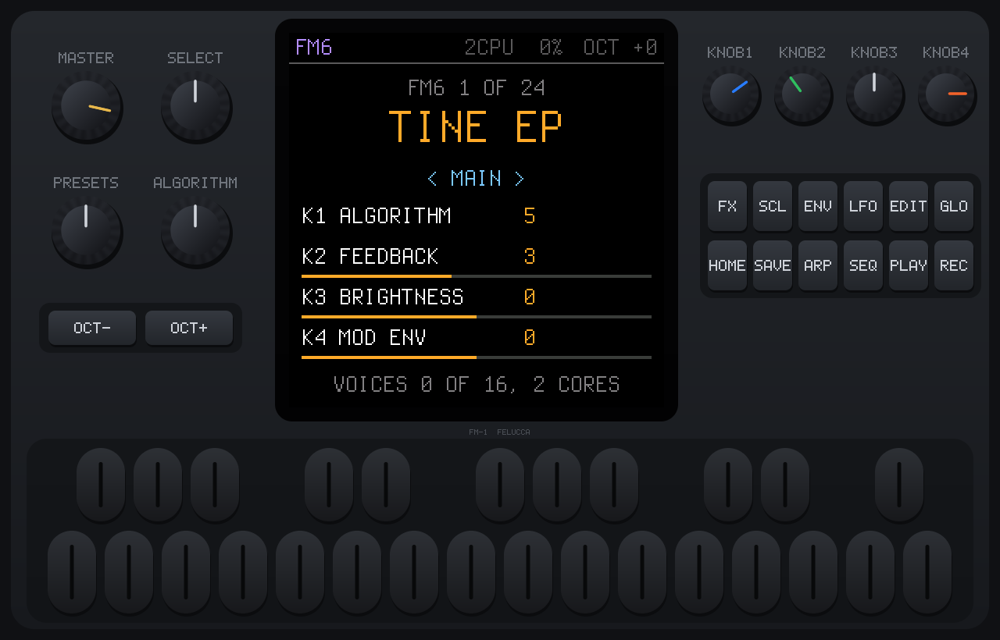
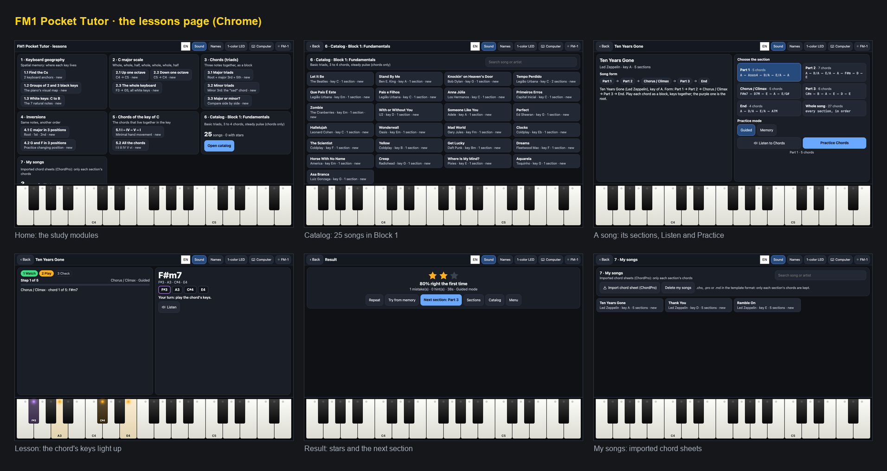
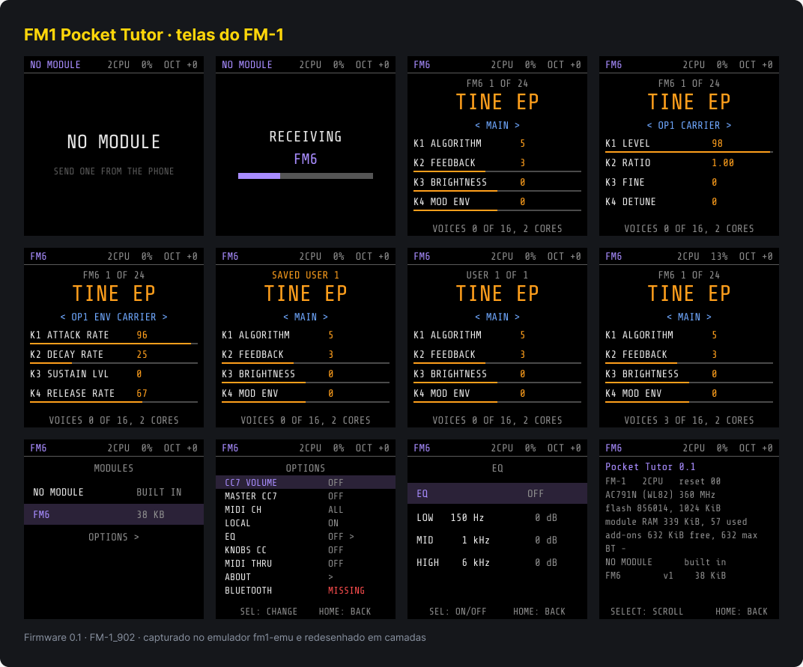

# FM1 Pocket Tutor

<p align="center"></p>

**A study firmware for the M-VAVE FM-1: the keyboard becomes the teacher.** The 27 keys (F3–G5) light up to show
where to play, the FM-1 plays the right sound, and a lesson page in Chrome guides you (watch → play → check):
notes, scales, chords and the chord progressions of real songs, section by section.

**Firmware de estudo musical para o M-VAVE FM-1: o teclado vira o professor.** As 27 teclas (Fá3–Sol5) acendem
para mostrar onde tocar, o FM-1 toca o som certo e a página das aulas no Chrome guia o estudo (observe → toque →
confira): notas, escalas, acordes e as progressões de músicas de verdade, seção por seção.

| | |
|---|---|
| Firmware | `FM-1_902`, nome USB `FM1 Pocket Tutor`, tela `POCKET TUTOR`. O pacote já traz o FM6; o Bluetooth MIDI volta numa versão seguinte |
| Som | o módulo **FM6** (6 operadores, timbres DX7), com o botão SAVE gravando seus presets (USER 1…32) |
| Aulas | [`docs/prototipo-aulas.html`](docs/prototipo-aulas.html): abra no **Chrome** (o Safari não tem Web MIDI). Em português, inglês e espanhol |
| Licença | GPL-3.0-only, derivado do [fm1-dock](https://github.com/joakimeriksson/fm1-dock) |

## O que faz

- **Luzes guia nas teclas.** A página manda notas no canal MIDI 16 (nota = a tecla, 53–79; velocity 1–63 brilho
  fraco, 64–126 acesa, 127 piscando; CC 123 apaga tudo). O firmware acende os LEDs e não toca essas notas.
- **Aulas no navegador**: teclado de 27 teclas na tela, modo computador (teclado QWERTY), calibração de oitava,
  nomes das notas, LEDs de 1 cor (amarelo = onde tocar; vermelho fica para erro).
- **Catálogo de músicas**: cada música vira lições com as partes da forma (estrofe, refrão, ponte…) e a música
  inteira. Só a harmonia: acordes, sem letra nem melodia.
- **Módulos de músicas**: blocos de músicas publicados em [`docs/songpacks`](docs/songpacks) (só acordes, por seção); o módulo de teste já vem na página.
- **Suas músicas**: importe cifras em ChordPro (`.md`/`.cho`, com `{start_of_verse: Parte 1}` etc.); a página lê os
  acordes (inclusive `G/B`, `D9/F#`, `A5`, `Bm7(b5)`) e monta as notas dentro das 27 teclas.

## A página das aulas

<p align="center"></p>

## Telas do FM-1

<p align="center"></p>

## Instalar

1. Grave `fm1-pocket-tutor-X.Y.fwsc` (da página de releases) no FM-1 pelo
   [FM-1 Firmware Hub](https://thefirmwarehub.com) ou com `python3 tools/fm1_install.py --port "FM1 Pocket Tutor"`
   (um FM-1 com firmware de fábrica precisa antes de um firmware que fale o protocolo Felucca).
2. O som já vem no pacote: o FM-1 liga direto no **FM6**.
3. Abra `docs/prototipo-aulas.html` no Chrome, escolha a porta **FM1 Pocket Tutor** e calibre a oitava.

## Build it

You need Linux on x86-64 (or macOS / Windows with Docker or WSL), Python 3 with Pillow, the JieLi toolchain and three
files of the JieLi AC79 SDK:

```sh
pip3 install Pillow mido python-rtmidi
tools/get_toolchain.sh                      # JieLi's clang for the chip, to ~/.jieli/toolchain
git clone --depth 1 --branch AC79NN_SDK_V1.2.1_2023-12-13 \
    https://gitee.com/Jieli-Tech/fw-AC79_AIoT_SDK.git ~/fw-AC79_AIoT_SDK
./build.sh      # -> build/fm1-pocket-tutor.fwsc; the sound modules as build/modules/*.dock (fm6, sine)
```

The build fails on what would brick the FM-1.

In the emulator, without an FM-1 (the same package, and with `--flash` the same flash, deployed modules included):

```sh
fm1-live --fwsc build/fm1-pocket-tutor.fwsc --flash flash.bin
tools/dock.py emu --fwsc build/fm1-pocket-tutor.fwsc --deploy build/modules/fm6.dock --ms 6000
```


The platform underneath is Dinghy's: [docs/API.md](docs/API.md) (everything `platform.c` gives), [docs/RULES.md](docs/RULES.md)
(the chip's rules and what the build checks), [docs/MAKE-IT-YOURS.md](docs/MAKE-IT-YOURS.md).

## Credits

- **FM1 Pocket Tutor** (the guide LEDs, the lessons page, FM6's SAVE): Wellington Saam, built on fm1-dock.
- **fm1-dock** (the host, the module interface, the tools, the page), **FM-1 SID** and **Scintilla**: Joakim Eriksson.
- **The modules**: CS-1, twochannels. OberVave, zvenson. FM-106, PatttF (its DSP after
  [ultramaster_kr106](https://github.com/kayrockscreenprinting/ultramaster_kr106)). AMB-1, FoMni and MONK-1, Charles
  Vestal (MONK-1's voice: Jonathan Taylor's MonkSynth). FiMba-1, Adam Sowers. GATOR, npi3pak (Plaits and stmlib:
  Emilie Gillet). DUB-1, sbegueria (after AMB-1). ARTIHIVE, KHAV. reSID: Dag Lem.
- **The base**: [Dinghy](https://github.com/zvenson/dinghy) (zvenson), on the platform of
  [Felucca](https://github.com/hugelton/Felucca) (Leo Kuroshita, Hügelton Instruments) as
  [SLOOP](https://github.com/isod89/sloop-fm1) (isod89) carries it.
- **Bluetooth MIDI**: [Optimist](https://github.com/w0ts/optimist)'s BLE-MIDI stack (w0ts). The radio's calibration
  (`fm1_rf_cal.h`): JieLi's AC79 SDK calibration, in C by Charles Vestal for [fm1-base](https://github.com/charlesvestal/fm1-base)
  and [Melodee](https://github.com/keremimo/melodee), Apache-2.0; its hooks after Melodee's.
- **The second core and the power-up**: Charles Vestal's [X0X](https://github.com/charlesvestal/fm1-x0x), after Kerem
  Kilic's Melodee, by way of SLOOP's dual-core branch (Andre Rezemini). From Melodee (Kerem Kilic): the supplies'
  start-up, in the form of Optimist's `fm1_supply.h`, and the second core's hold.
- **The SMK-37**: genkigenki's [fm1-to-smk37](https://github.com/genkigenki/fm1-to-smk37) kit and its reference port,
  SLOOP's `smk37` branch.
- The keys' force sensing comes from Velo, by way of CS-1. The font is Terminus (SIL OFL 1.1).

GPL-3.0-only: you may change and share it, and whoever gets your firmware gets its source. Who made what, file by
file, and the third-party parts: [LICENSING.md](LICENSING.md). Not affiliated with M-VAVE.
